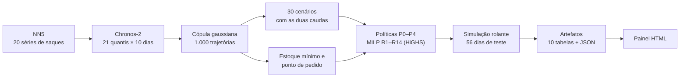

# Cadeia de suprimento de numerário em ATMs

Previsão probabilística (Chronos-2) + MILP estocástico multiescalão + simulação em horizonte rolante para decidir, toda noite, quanto numerário manter na tesouraria central, nas tesourarias das agências e nos ATMs; quando retirar ou devolver à custódia do Banco Central; quando e quanto suprir cada ponto (transportadora convencional ou especial); e quanto tempo do gerente operacional (GO) dedicar aos ATMs internos.

Projeto da disciplina **Pesquisa Operacional Aplicada** (UFABC, 2026.3) — Thiago Bibiano da Silva.

[](https://colab.research.google.com/github/ThiagoBibiano/poa-supply-chain-atm-cash/blob/main/notebooks/poa_numerario_colab.ipynb)



A especificação completa — rede, modelo matemático, estoques de segurança, políticas, métricas, contrato de dados e as decisões de implementação — está em [`docs/especificacao.md`](docs/especificacao.md).

## Como rodar no Colab

1. Abra o notebook pelo botão acima e escolha **Ambiente de execução → Alterar o tipo → GPU (T4)**. O Chronos-2 roda em CPU, mas bem mais devagar.
2. **Executar tudo.** A célula 1 monta o Google Drive, clona este repositório e instala as versões fixadas (`pulp`, `highspy`, `chronos-forecasting`). Se o repositório virar privado, guarde um token de leitura em **Secrets** do Colab com o nome `GITHUB_TOKEN`.
3. Na célula 2 (CONFIG), escolha o `MODO`:

   | MODO | Previsão | Cenários | Tempo por noite (MILP) | Uso |
   |---|---|---|---|---|
   | `completo` | Chronos-2 | 30 | até 60 s | resultado da apresentação |
   | `rapido` | Chronos-2 | 15 | até 30 s | iterar parâmetros |
   | `teste_local` | SeasonalNaive | 10 | até 30 s | testar o encadeamento sem internet nem GPU (dados sintéticos) |

4. Os artefatos ficam em `MyDrive/poa_numerario/expA_<MODO>/`. Cada etapa cara grava cache (previsões por origem, cenários por noite, checkpoint do backtest a cada 7 noites): se a sessão cair, rode de novo e ela continua de onde parou. No fim, o `painel-numerario.html` é baixado.

Todos os parâmetros — custos, prazos, tempos do GO, escala monetária, nível de serviço, solver — estão no bloco CONFIG (e em [`src/numerario/config.py`](src/numerario/config.py)). Os custos e a escala são **ilustrativos**: o NN5 não os tem.

### Tempo de execução

Medido numa máquina de 2 vCPUs, como a do Colab (o HiGHS usa um núcleo). O P3 domina:

| Etapa | `completo` |
|---|---|
| Dados, rede, calibração, cenários e estoques de segurança | poucos minutos |
| Previsão Chronos-2 (≈ 180 origens × 20 séries) | minutos na GPU |
| P0, P2 (regras) | < 1 min cada |
| P1, P4 (MILP com um cenário) | ~ 1 min cada |
| P3 (MILP estocástico, 30 cenários, 70 noites de até 60 s de solver) | **≈ 1h05** |
| Sensibilidade (opcional; P1 + P3 com 10 cenários em cada ponto da grade) | ~ 25 min por ponto (a grade padrão tem 5 pontos distintos) |

No teste de ponta a ponta (dados sintéticos, 30 cenários), 55 das 70 noites do P3 pararam no limite de 60 s, com gap mediano de 3% (máximo de 12%); o painel mostra tempo e gap por noite. No modo `rapido`, o P3 leva cerca de metade do tempo.

## Rodar localmente

```bash
pip install -e ".[dev]"            # acrescente ".[chronos]" para o Chronos-2
pytest                              # 16 testes: calendário, dados, cenários, estoque de segurança, MILP, simulador e painel
cd notebooks && POA_MODO=teste_local jupyter nbconvert --to notebook --execute \
    --ExecutePreprocessor.timeout=-1 --output executado.ipynb poa_numerario_colab.ipynb
```

Fora do Colab, os artefatos vão para `saidas/` (ignorada pelo git). As variáveis `POA_MODO`, `POA_RAIZ`, `POA_CENARIOS`, `POA_TEMPO_LIMITE` e `POA_TESTE_FIM` sobrepõem o CONFIG sem editar o notebook.

## O que sai

```
expA_completo/
├── 01_dados/        NN5 baixado (MD5 conferido), saques em R$ mil, indisponibilidade, calendário, pontos
├── 02_previsoes/    quantis por modelo, origem, série e horizonte (cache)
├── 03_cenarios/     cenários, probabilidades e estoques de segurança por noite (cache)
├── 04_backtest/     resultado e checkpoint de cada política
├── 05_artefatos/    ← o que interessa
└── 06_execucoes/    diagnósticos (origem e MD5 dos dados, feriados, previsão, calibração)
```

Em `05_artefatos/`:

| Arquivo | Conteúdo |
|---|---|
| `pontos`, `estoque_minimo`, `custodia`, `previsoes`, `realizado`, `decisoes`, `estados`, `custos`, `modelo`, `execucoes` (`.parquet`) | as 10 tabelas do contrato de dados do painel (valores em R$ mil, custos em R$) |
| `painel.json` | o JSON que o painel consome |
| `painel-numerario.html` | página única (JavaScript puro e SVG) com o JSON embutido — abre offline (sem internet, as fontes caem para as do sistema) |
| `resumo_para_slides.md` | esqueleto em markdown com os números principais |
| `manifesto.json` | configuração completa e hashes dos arquivos (a origem dos dados e os diagnósticos ficam em `06_execucoes/diagnosticos.json`) |

Para análises depois do notebook:

```python
import json, pandas as pd
from numerario import artefatos as art

RAIZ = "/content/drive/MyDrive/poa_numerario/expA_completo"
REPO_DIR = "/content/poa-supply-chain-atm-cash"
estados = pd.read_parquet(f"{RAIZ}/05_artefatos/estados.parquet")   # saldos e fluxos por política, ponto e dia
custos  = pd.read_parquet(f"{RAIZ}/05_artefatos/custos.parquet")    # custo por componente

# regenerar o HTML a partir do JSON salvo, sem rodar nada (por exemplo, depois de mudar o template)
art.escrever_painel(json.load(open(f"{RAIZ}/05_artefatos/painel.json")),
                    f"{REPO_DIR}/painel/template.html", f"{RAIZ}/05_artefatos/painel-novo.html")
```

O painel tem: mapa da cadeia com inspetor por ponto e dia, indicadores do período, registro de mudanças de decisão (plano D−3/D−2 × executado), comparação de políticas, impacto do erro (custo vs. oráculo, VSS, EVPI), calibração da previsão por cauda, rede e centralização (estoque separado × concentrado, custódia × recirculação), tempo e gap do solver por noite, uso dos minutos do GO, sensibilidade (quando rodada) e os critérios de aceite conferidos nos dados.

## Estrutura do repositório

```
notebooks/poa_numerario_colab.ipynb   notebook de execução e apresentação
painel/template.html                  painel (o notebook injeta o JSON no marcador __DADOS_DO_NOTEBOOK__)
docs/especificacao.md                 especificação consolidada e decisões de implementação
src/numerario/
├── config.py            CONFIG central (dataclasses)
├── calendario.py        feriados, dias de operação, períodos de proteção, prazos da custódia
├── dados.py             download e leitura do NN5 (.tsf), seleção, imputação causal, escala
├── rede.py              rede piloto: pontos, capacidades, tetos, reservas, tempos do GO
├── previsao.py          Chronos-2 e SeasonalNaive quantílico, com cache por origem
├── cenarios.py          função quantil, PIT, cópula, trajetórias, redução com caudas
├── estoque_seguranca.py EM/PP das agências e da central, ganho de centralização, Baumol, Miller–Orr
├── modelo.py            MILP de dois estágios (R1–R14) em PuLP + HiGHS
├── politicas.py         P0 (regra fixa), P1 (mediana), P2 (quantis), P3 (estocástico), P4 (oráculo)
├── simulacao.py         execução diária contra a demanda real, custos, checkpoint
├── metricas.py          WQL, cobertura por cauda, PIT, VSS, EVPI, mudanças de decisão
├── artefatos.py         tabelas do contrato, conferências, JSON e HTML do painel
├── pipeline.py          orquestração usada pelo notebook
└── pulp_compat.py       camada de compatibilidade PuLP 3.x / 4.x
tests/                                testes (pytest)
```

## Referências

Os artigos de base (Eppen, 1979; Graves e Willems, 2000; Miller e Orr, 1966; Dawande et al., 2010; van Anholt et al., 2016; Zhou et al., 2020; López Lázaro et al., 2018; Phan et al., 2026) e os demais citados estão listados em [`docs/especificacao.md`](docs/especificacao.md#10-referências-pdfs-no-project).
