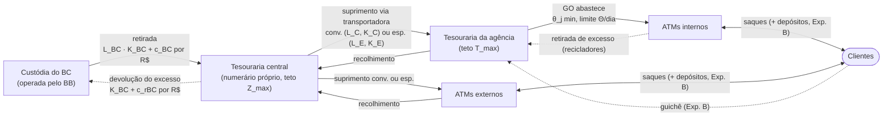

# Especificação implementada

Consolidação do que foi especificado na proposta (`proposta-otimizacao-numerario.md`, revisão multiescalão de 31/10/2026), no painel publicado ("Painel da Cadeia de Numerário", especificação v0.1) e no planejamento do backtest (01/11/2026), com o módulo do pacote que implementa cada parte. A seção 9 lista as decisões de implementação que a proposta deixava em aberto ou que foi preciso ajustar.

## 1. Problema

A rede de numerário de uma região tem três níveis de estoque: uma **tesouraria central** (numerário próprio, centro de distribuição), as **tesourarias das agências** e os **ATMs** — internos (abastecidos pelo gerente operacional, GO, a partir da tesouraria da agência) ou externos (supridos pela transportadora direto da central). A central é reposta pela **custódia do Banco Central**, operada pelo BB, que cobra tarifa proporcional ao valor de cada retirada e devolução (Resolução BCB nº 134/2021). A transportadora sempre atende no prazo, em convencional (barata, prazo maior) ou especial (cara, prazo menor).

> Quanto numerário manter na tesouraria central e quanto nas agências e ATMs; quando retirar ou devolver à custódia; quando e quanto suprir ou recolher cada ponto, e por qual modalidade; e quanto tempo do GO dedicar aos ATMs internos — de modo a minimizar custos operacionais e de oportunidade sob demanda incerta?

**Ordem dos eventos no dia t** (`simulacao.executar_dia`): (1) na central chega a retirada da custódia, os recolhimentos processados viram numerário e sai a devolução; (2) a central despacha as visitas do dia, a transportadora entrega e recolhe; (3) em dia útil o GO abastece os internos com o que está no cofre; (4) saques, depósitos e guichê — saque sem saldo é ruptura, depósito acima da capacidade é recusado; (5) fecham-se os saldos e, à noite, a política decide.

## 2. Tipo de modelo

Programa estocástico inteiro misto de **dois estágios**, resolvido pelo equivalente determinístico por cenários e **reotimizado toda noite** (horizonte rolante de 10 dias, só o 1º estágio é executado — Bilir e Döşeyen, 2018; Castro, 2009). A **simulação** avalia as políticas contra a demanda real. Python, PuLP + HiGHS (`modelo.py`).

## 3. Modelo matemático (`modelo.py`)

**Conjuntos.** b ∈ 𝓑 agências; j ∈ 𝓙_b internos; k ∈ 𝓚 externos; n ∈ 𝓝_c = 𝓑 ∪ 𝓚 pontos supridos pela central; a ∈ 𝓐 = 𝓙 ∪ 𝓚 (𝓐^R recicladores, Exp. B); m ∈ {C, E}; t = t₀+1 … t₀+H; ω ∈ Ω com probabilidade π_ω.

**Variáveis.** v^m_{n,t} ∈ {0,1} visita pedida em t (executa em t + L_m) e x^m_{n,t} valor; r_{n,t} recolhimento; y_{j,t} ∈ {0,1}, q_{j,t}, s_{j,t} agenda do GO; β_{c,t}, b_{c,t} retirada e δ_{c,t}, g_{c,t} devolução na custódia; I, T, Z saldos; u, w, u^T, o, e, e^CD folgas. Auxiliares: ν_{n,t} = Σ_m v^m_{n,t−L_m}, S_{n,t} = Σ_m x^m_{n,t−L_m} (inclui pedidos pendentes).

**Objetivo.** min Σ_ω π_ω Σ_t (C^num + C^transp + C^GO + C^opor + C^pen):

- C^num = Σ_c [K^BC (β + δ) + c^BC b + c^rBC g] + c^P Σ_n r
- C^transp = Σ_n Σ_m K^m v^m + κ Σ_n (S + r)
- C^GO = Σ_b c^GO (Σ_j θ_j y_j + θ^CF ν_b)
- C^opor = h (Σ_a I + Σ_b T + Σ_c Z)
- C^pen = Σ_a (p u + p_w w) + Σ_b (p^T u^T + p^o o + p^EM e) + Σ_c p^EM e^CD

**Restrições.**

| | Restrição | Implementação |
|---|---|---|
| R1 | I_j,t = I_j,t−1 + q − s + (G − w) − (D − u) | balanço por cenário |
| R2 | I_k,t = I_k,t−1 + S − r + (G − w) − (D − u) | idem; `ov` devolve à central o que não couber (seção 9) |
| R3 | T_b,t = T_b,t−1 + S − r − Σ_j (q − s) + F + u^T | u^T ≤ saques de guichê do dia |
| R4 | Σ_j q ≤ T_b,t−1 + S − r + Σ_j s | o GO só usa o que está no cofre |
| R5 | Σ_j θ_j y_j + θ^CF ν_b ≤ Θ_b,t | Θ = 0 sem expediente (a agência fechada não recebe transportadora) |
| R6 | q + s ≤ Cap_j y; x ≤ M_n v; r ≤ M_n ν | M_k = Cap_k, M_b = T^max_b; r ≤ saldo antes da visita |
| R7 | 0 ≤ I ≤ Cap; T ≤ T^max + o; u ≤ D; w ≤ G | mais R7b: carga da manhã ≤ Cap |
| R8 | v^m_{n,t} = 0 se Λ_{t+L_m} = 0 | variável nem é criada |
| R9 | não antecipatividade das decisões de hoje | variáveis do 1º estágio compartilhadas pelos cenários |
| R10 | T_b + e_b ≥ EM_b,t (flexível) | EM por política (seção 7) |
| R11 | Z_t = Z_t−1 + b_{t−L_BC} − g + Σ r_{t−L_P} − Σ S | balanço da central |
| R12 | 0 ≤ Z ≤ Z^max | com folga penalizada (seção 9) |
| R13 | b ≤ Z^max β; g ≤ Z^max δ; só em dia útil da custódia | calendário filtrado na criação |
| R14 | Z + e^CD ≥ EM^CD_t (flexível) | |

## 4. Estoque de segurança (`estoque_seguranca.py`)

**Agências (5.6).** W_{b,x} = Σ_j Σ_{y=x}^{g(x)−1} D_{j,y} − F_{b,x} (a sexta carrega o fim de semana); 𝒫_{b,t} = {t+1, …, a_t − 1}, a_t = 1º dia com transportadora ≥ t + R + L_C; **EM** = max{R_b; Q_α(ΣW) − Q_0,5(ΣW)}; **PP** = Q_0,5(ΣW) + EM. Q_α é o quantil **da soma**, calculado nas trajetórias. Aproximação para conferência: EM ≈ z_α √((1−ρ)Σσ² + ρ(Σσ)²), σ ≈ (Q95 − Q05)/(2·1,645). α = 95% (sensibilidade 90/95/99%).

**Central (5.7–5.8).** W^CD = Σ_b W_b + Σ_k D_k − Σ_n r; 𝒫^CD = até a chegada de um pedido feito no próximo dia útil; EM^CD pela mesma fórmula; **ganho de centralização** G = Σ_n EM_n(sozinho) − EM^CD (Eppen, 1979); lote de **Baumol** Q* = √(2K^BC W̄/h); faixa de **Miller e Orr** z = L + (3K^BC σ²/4h)^{1/3}, H = 3z − 2L, L = EM^CD; **ida e volta**: devolver X compensa se h·X·τ > 2K^BC + (c^rBC + c^BC)X. Divisão entre níveis (Graves e Willems, 2000): a agência cobre o prazo da transportadora; a central, o da custódia.

## 5. Previsão e cenários (`previsao.py`, `cenarios.py`)

- **Chronos-2** zero-shot (`amazon/chronos-2`, chronos-forecasting 2.3.2): 21 quantis (0,01 … 0,99), H = 10, janela expansiva, NaN nos dias indisponíveis, covariáveis de calendário (feriado, dias até/desde o feriado). **SeasonalNaive quantílico** como referência.
- **Função quantil**: interpolação monotônica entre os 21 quantis, linear em z = Φ⁻¹(τ), com extrapolação de cauda; saque truncado em zero.
- **Dependência**: PITs da calibração → z → correlação entre ATMs e entre horizontes (Kronecker) com encolhimento; **cópula gaussiana** (t como checagem).
- **Redução**: 1.000 trajetórias → 30 cenários por k-medoides, com **as duas caudas** (5% de demanda mais baixa e mais alta no período de proteção) como grupos próprios, com sua probabilidade.
- **Calibração por cauda**: cobertura de Q01/Q05/Q10 e Q90/Q95/Q99 separadas, PIT, erro por antecedência e em feriados (`metricas.py`).
- **Recalibração quantílica** (`cfg.previsao.recalibrar_quantis`, ligada no notebook): com G a distribuição empírica dos PITs da janela de calibração, por grupo de série (saque, depósito, guichê) e antecedência, o quantil de nível τ passa a ser o quantil bruto de nível τ' = G⁻¹(τ) (recalibração por PIT, à la Kuleshov, Fenner e Ermon, 2018). Corrige as duas caudas de forma independente. O mapa usa só alvos até a véspera do teste e é aplicado a todas as origens; a cópula, os cenários e os estoques mínimos passam a usar os quantis recalibrados. As previsões brutas ficam no cache (a opção não entra na chave das previsões) e as métricas do teste aparecem com e sem recalibração. Motivo: na 1ª execução com o Chronos-2, Q90 e Q95 cobriram 86,9% e 93,5% na calibração, e as rupturas vêm da cauda alta.

## 6. Dados (`dados.py`)

NN5 com faltantes (Zenodo 4656110, MD5 conferido): 111 séries × 791 dias desde 18/03/1996. 20 séries sorteadas (semente 2026) entre as com ≤ 5% de lacunas/zeros na janela calibração + teste: 12 internos (3 por agência) e 8 externos. Lacunas e zeros = indisponibilidade (demanda censurada), imputados pela mediana do mesmo dia da semana nas 4 semanas anteriores. Escala para R$ mil pelo saque médio do CONFIG. Exp. B: depósitos e guichê sintéticos a partir de outras séries do NN5.

| Bloco | Período | Dias |
|---|---|---|
| Histórico (contexto) | 18/03/1996 – 16/11/1997 | ~609 |
| Calibração | 17/11/1997 – 08/03/1998 | 112 |
| Aquecimento | 09/03 – 22/03/1998 | 14 |
| Teste | 23/03 – 17/05/1998 | 56 |

## 7. Experimentos, políticas e métricas (`politicas.py`, `simulacao.py`, `metricas.py`)

| Política | Método | Estoque mínimo |
|---|---|---|
| P0 Regra fixa | média histórica + margem (calibrada), sem sazonalidade; especial se o saldo não cobre o prazo; central retira o que falta para o dia seguinte | reserva fixa |
| P1 Mediana | mesmo MILP, cenário único = P50 | só R_b, R_c |
| P2 Clássicas por quantil | base-stock pelo quantil da soma (Phan et al., 2026) com teto pelo quantil inferior (Zhou et al., 2020); especial como 2º índice (Veeraraghavan e Scheller-Wolf, 2008); GO por menor cobertura até Θ; central (s,Q) com Baumol e Miller–Orr | fórmula (PP gatilho, EM piso) |
| P3 MILP estocástico | dois estágios, 30 cenários | R10/R14 flexíveis |
| P4 Oráculo | MILP com a demanda real | só R_b, R_c |
| P3_sem_EM (opcional) | P3 sem R10/R14 | mede o preço do estoque mínimo |

**Experimento A** (núcleo): saques reais, sem depósitos, guichê nulo. **Experimento B**: recicladores (50%) e guichê sintéticos. **Configuração da rede**: estoque de segurança concentrado na central × distribuído (`cfg.es.configuracao_rede`).

**Métricas** (janela de teste): custo total e por componente; nível de serviço, rupturas, falta no guichê; estouros de teto, depósitos recusados, saldo parado; especiais, minutos do GO, dias com fila; custódia, recirculação, onde o dinheiro fica; **custo do erro** (vs P4) separado em falta e excesso; **VSS** = custo(P1) − custo(P3); **EVPI** = custo(P3) − custo(P4); mudanças de decisão (plano D−3/D−2 × executado, com classe e motivo), nervosismo do plano, especiais reativas, divergência do oráculo.

## 8. Contrato de dados do painel (`artefatos.py`)

Valores em R$ mil; custos em R$. Parquet em `05_artefatos/` e JSON embutido no HTML.

| Tabela | Chave | Campos |
|---|---|---|
| pontos | ponto | tipo (bc, cd, tes, int, ext), central, agência, reciclador, capacidade, teto, reserva, α, θ |
| estoque_minimo | ponto, data | dias de proteção, saída mediana, EM (trajetórias), EM por independência e por soma dos quantis, aproximação com ρ, PP, α, ρ; central: total separado e ganho |
| custodia | política, central, data | tipo (retirada, devolução), valor, tarifa, fixo |
| previsoes | ponto, origem, alvo | h, q01 … q99 |
| realizado | ponto, data | saques, indisponível |
| decisoes | política, ponto, data_decisao, data_execucao, tipo | tipo (C, E, GO, RGO, REC, BC, DEV), valor, minutos, estágio (1 executada, 2 plano), prob |
| estados | política, ponto, data | saldo anterior/início/fim, chegada, recolhimento, abastecimento GO, saque, depósito, não atendido, excesso, fila do GO, visitas, minutos; central: entrada da custódia, recolhimento processado, despacho, devolução, falta para despachar |
| custos | política, ponto, data, componente | valor (conv, esp, go, opor, rupt, estouro, num) |
| modelo | política, data, restrição, ponto | ativa, folga, dual |
| execucoes | política, data | status, gap, segundos, variáveis, binárias, cenários |

Os critérios de aceite do painel são checados no notebook (`artefatos.conferencias`) e aparecem no próprio HTML.

## 9. Decisões de implementação

1. **Ciclo de decisão**: toda noite corrida (como no protótipo). A alternativa "só dia útil" ficou em aberto na conversa de 01/11 e não foi implementada.
2. **1º estágio** = pedidos à transportadora emitidos hoje, recolhimentos e agenda do GO de amanhã, pedido e devolução à custódia de hoje (R9).
3. **Devolução à custódia**: emitida em t, sai da central no dia de chegada a(t) = t + L_BC úteis (mesma defasagem da retirada).
4. **Integralidade** só nos 2 primeiros dias do horizonte; o resto é relaxado (seção 4.6, "Escala").
5. **Especial só como recurso**: no 2º estágio cada cenário enxerga o próprio futuro, então a especial pedida a partir do 2º dia perde sempre para a convencional pedida na véspera (mesmo dia de execução, mais barata). Essas variáveis não são criadas — o ótimo não muda.
6. **Partida a quente e limite de tempo**: o P3 parte da solução determinística da mediana (as binárias da mediana, com os valores reotimizados nos 30 cenários) e tem 60 s por noite. Com 30 cenários a raiz do branch-and-bound consome quase todo esse tempo em cortes; o que muda a decisão em relação à partida são as heurísticas RINS/RENS do HiGHS, que ficam ligadas (padrão). A maioria das noites termina no limite de tempo com gap de alguns por cento — o painel mostra tempo e gap por noite. Relaxar também o 2º dia (só o 1º estágio inteiro) resolve em segundos, mas o modelo passa a adiar pedidos (paga só uma fração do custo fixo das visitas futuras), por isso não é o padrão.
7. **Viabilidade com o estado real**: nos ATMs externos, o que um pedido já emitido não couber volta à central (`ov`, penalidade p^o + κ); na central, "falta para despachar" e excesso sobre Z^max têm folga penalizada. Sem isso, o estado herdado da simulação pode tornar a versão rígida inviável.
8. **Capacidade na carga (R7b)**: o saldo da manhã, depois de abastecer, não passa de Cap_a (a R7 da proposta limita só o fim do dia).
9. **Dual de R5 com as binárias fixadas é zero por construção** (a linha só tem binárias). O valor de um minuto do GO sai da sensibilidade custo × Θ (diferença finita); os duais continuam calculáveis (`cfg.solver.calcular_duais`).
10. **Penalidade de ruptura** p = h·ρ*/(1−ρ*) com ρ* = 99% (≈ R$ 38 por R$ mil), como na proposta (o protótipo usava R$ 120 ilustrativos). p^T = 1,25p, p_w = 0,5p, p^o = p^EM = R$ 5 por R$ mil/dia.
11. **EM além do horizonte de previsão**: dias de proteção depois de t₀ + H usam a coluna do mesmo dia da semana uma semana antes.
12. **Ganho de centralização**: usa o mesmo ρ dentro e entre pontos, o que dá G = 0 com ρ = 1 (critério de aceite). Com ρ = 0 dentro do ponto reduz-se à fórmula da proposta. O painel mostra a versão por trajetórias e a aproximação. Três números diferentes, que não precisam bater: (i) a **conferência** usa a aproximação normal numa noite só (a 1ª do teste); (ii) a **tabela** `estoque_minimo` tem, por noite, a versão por trajetórias (`ganho_centralizacao`, quantil α da soma) e a aproximação (`ganho_aprox`); (iii) o **notebook e o painel** mostram a média das noites do teste por trajetórias. A conferência imprime os três. Os quantis são guardados em float64: o Chronos-2 devolve float32, e a soma de centenas de σ em float32 erra na 4ª–5ª casa — foi o que fez a conferência com ρ = 1 falhar na 1ª execução. A tolerância é relativa ao total separado (10⁻⁹).
13. **Recicladores (Exp. B)**: a saída da tesouraria usa o saque líquido D − G.
14. **Mudança de decisão**: plano do MILP estocástico = valores esperados nos cenários; uma visita conta como planejada se a probabilidade nos cenários é ≥ 50%. Nas regras (P0, P2), o plano vem de projetar as próximas noites com a demanda mediana.
15. **Tesouraria só recebe transportadora em dia de expediente** (consequência de R5 com Θ = 0).

## 10. Referências (PDFs no Project)

BILIR e DÖŞEYEN (2018); CASTRO (2009); CLARK e SCARF (1960); DAWANDE et al. (2010) — *An analysis of coordination mechanisms for the U.S. cash supply chain*; EPPEN (1979) — *Effects of centralization on expected costs in a multi-location newsboy problem*; GRAVES e WILLEMS (2000) — *Optimizing strategic safety stock placement in supply chains*; LÓPEZ LÁZARO, BARBERO JIMÉNEZ e TAKEDA (2018) — *Improving cash logistics in bank branches by coupling machine learning and robust optimization*; MILLER e ORR (1966) — *A model of the demand for money by firms*; PHAN, LE e QUAN (2026) — *Uncertainty-aware forecasting and inventory optimization for ATM cash management in Vietnam* (FLINS 2026); VAN ANHOLT et al. (2016) — *An inventory-routing problem with pickups and deliveries arising in the replenishment of ATMs*; ZHOU et al. (2020) — *Data-driven cash replenishment planning of recycling ATMs with out-of-cash and full-of-cash risks*; TRIGEIRO, THOMAS e McCLAIN (1989); VEERARAGHAVAN e SCHELLER-WOLF (2008); KAPLAN e ANDERSON (2004); BAUMOL (1952); ANSARI et al. (2025) — Chronos-2; KULESHOV, FENNER e ERMON (2018) — *Accurate uncertainties for deep learning using calibrated regression* (recalibração por PIT).
